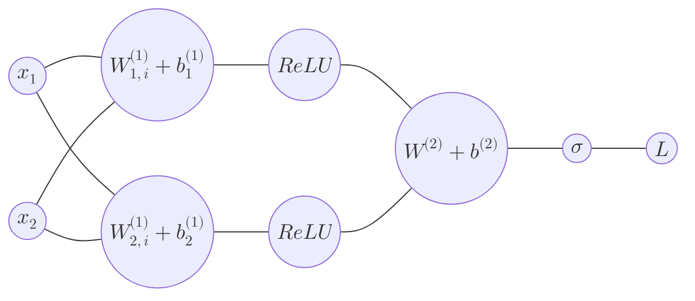

# An Example Of a Toy NN

## Setup

**Architecture**: 2 inputs $\to$ 2 hidden units ($ReLU$) $\to$ 1 output (Sigmoid).  
**Loss**: $L=\frac{1}{2}(\hat{y}-y)^{2}$  

**Input and target**:
$$
\mathbf{x}=\begin{bmatrix}
1 \\
2
\end{bmatrix}, \; y=1
$$
**Layer 1 (hidden):**

$$
W^{(1)}= \begin{bmatrix}
0.5 & 0.25 \\
-1 & 0.5 
\end{bmatrix}, \mathbf{b}^{(1)} = \begin{bmatrix}
0 \\
-0.5
\end{bmatrix}
$$
**Layer 2 (output):** 
$$
W^{(2)} = \begin{bmatrix}
1 & -2
\end{bmatrix}, \; \mathbf{b}^{(2)} = -1
$$
**Equations:** 
$$
\begin{aligned}
\mathbf{z}^{(1)}  & = W^{(1)} \mathbf{x}+ \mathbf{b}^{(1)}, \; \mathbf{h} = \mathrm{Re}LU(\mathbf{z}^{(1)}) \\
\mathbf{z}^{(2)}  & = W^{(2)} \mathbf{h} + \mathbf{b}^{(2)}, \; \hat{y} = \sigma(\mathbf{z}^{(2)}) 
\end{aligned}
$$

## 1. Forward pass

$$
\mathbf{z}^{(1)} = \begin{bmatrix}
0.5 & 0.25 \\
-1 & 0.5 
\end{bmatrix} \begin{bmatrix}
1 \\
2
\end{bmatrix} + \begin{bmatrix}
0 \\
-0.5
\end{bmatrix} = \begin{bmatrix}
1 \\
-0.5
\end{bmatrix},\; \mathbf{h}^{(1)} = \begin{bmatrix}
1 \\
0
\end{bmatrix}
$$

$$
\mathbf{z}^{(2)} = \begin{bmatrix}
1  & -2
\end{bmatrix} \begin{bmatrix}
1 \\
0
\end{bmatrix} - 1 = 0, \; \hat{y} = \frac{1}{2}
$$
$$
\mathcal{L}= \frac{1}{2} \cdot \frac{1}{4} = \frac{1}{8}
$$
## 2. Backprop
$$
\begin{aligned}
\delta^{(2)}  & = \frac{ \partial \mathcal{L} }{ \partial \mathbf{z}^{(2)} } = - \frac{1}{4} \\
\frac{ \partial \mathcal{L} }{ \partial W^{(2)} }  & = \delta^{(2)} \cdot \frac{ \partial \mathbf{z}^{(2)} }{ \partial W^{(2)}}   = \sigma(W^{(2)})(1- \sigma(W^{(2)}))
\end{aligned}
$$